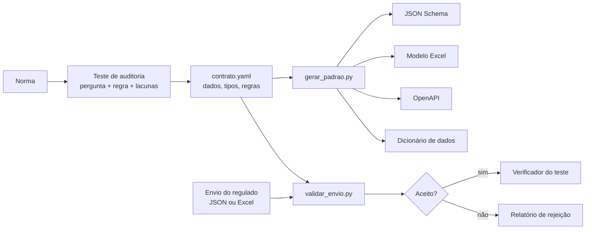

# Padrões de coleta de dados para auditoria regulatória

Método, modelos e ferramentas para que **agências reguladoras** transformem um **teste de auditoria** em um **padrão de coleta de dados** junto aos regulados, com regras claras de envio, validação e aceite.

O problema que o repositório resolve: a agência quer verificar automaticamente o cumprimento de uma obrigação (uma inspeção periódica, um prazo de atendimento, um indicador de qualidade). Para isso, precisa de três coisas que raramente estão escritas:

1. **uma regra que dê para computar**, com as ambiguidades da norma identificadas e decididas;
2. **a lista mínima de dados** necessária para aplicar a regra, e quem detém cada um;
3. **um formato de envio** que o regulado consiga produzir e que a agência consiga validar sem trabalho manual.

## Como funciona



A agência descreve o teste e os dados **uma única vez**, no arquivo `contrato.yaml`. A partir dele, as ferramentas geram:
- a planilha-modelo;
- o JSON Schema;
- a especificação da API;
- o dicionário de dados.

As mesmas ferramentas validam os envios recebidos.

## Conteúdo

| Pasta | Para quem | Conteúdo |
|---|---|---|
| [`metodo/`](metodo/) | fiscalização, procuradoria, TI | o método em 7 etapas, da norma ao aceite do envio |
| [`modelos/`](modelos/) | quem vai aplicar o método | ficha do teste de auditoria, contrato-modelo, minuta de ofício, checklist de homologação e catálogo de testes comuns |
| [`docs/formato-contrato.md`](docs/formato-contrato.md) | TI | especificação do `contrato.yaml` |
| [`ferramentas/`](ferramentas/) | TI | gerador de padrões e validador de envios (Python) |
| [`exemplos/ipg-gas-rj/`](exemplos/ipg-gas-rj/) | todos | caso completo: inspeção quinquenal de segurança das instalações de gás canalizado no Rio de Janeiro |

## Começo rápido

```bash
pip install -r ferramentas/requirements.txt

# gera os padrões de coleta a partir do contrato do exemplo
python ferramentas/gerar_padrao.py exemplos/ipg-gas-rj/contrato.yaml --saida exemplos/ipg-gas-rj/gerado

# valida um envio recebido (JSON ou Excel)
python ferramentas/validar_envio.py exemplos/ipg-gas-rj/contrato.yaml exemplos/ipg-gas-rj/envios/exemplo_envio_completo.json
```

Para um teste novo:
1. preencha a [ficha do teste de auditoria](modelos/ficha-teste-auditoria.md);
2. copie o [contrato-modelo](modelos/contrato-modelo.yaml) e ajuste-o ao teste;
3. rode o gerador.

## Princípios

- **Ler a norma vigente, não a citação.** A regra que circula costuma estar desatualizada. Antes de computar, mapeie as alterações e revogações.
- **Toda lacuna vira parâmetro.** O que a norma não decide fica explícito, com um valor provisório e com a indicação de quem decide. Cada veredito informa quais lacunas o influenciaram.
- **Três saídas, nunca chute.** CONFORME, NÃO CONFORME ou PRECISA DE DELIBERAÇÃO.
- **Fatos na data do fato.** Habilitações, prazos e situações são verificados na data em que o evento ocorreu.
- **Um contrato, vários canais.** API, planilha e arquivo carregam exatamente os mesmos campos.
- **Dados mínimos.** Só o necessário para o teste, com base legal e sem dados pessoais dispensáveis.

## Licença

- Código: [MIT](LICENSE).
- Textos e modelos: [CC BY 4.0](LICENSE-CONTEUDO.md).

Contribuições são bem-vindas: abra uma *issue* com o teste de auditoria que a sua agência quer automatizar.
