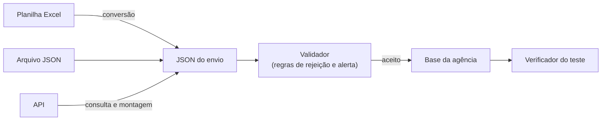

# Etapa 5 — Canais de envio

**Objetivo:** escolher como os dados descritos no contrato chegam à agência: arquivo JSON, planilha Excel ou API.

**Quem conduz:** TI da agência. **Quem participa:** TI dos regulados.

---

## 5.1 O conteúdo é o mesmo; muda o transporte

Os três canais carregam **exatamente os mesmos blocos, campos, nomes e domínios**, definidos no contrato ([Etapa 4](04-contrato-de-coleta.md)). A agência converte tudo para um formato interno único (o JSON do envio) e aplica o mesmo validador. Por isso, a escolha do canal é uma decisão de custo e de operação, não de conteúdo, e pode mudar com o tempo sem alterar o contrato.

## 5.2 Os canais

### Arquivo JSON

O regulado gera um arquivo `.json` no formato do envio e o entrega por canal seguro (portal autenticado, SFTP ou sistema de protocolo eletrônico).

- **Quando usar:** integração automatizada sem expor serviço; volumes médios e grandes; periodicidade mensal ou maior.
- **Esforço típico do regulado:** intermediário. Uma rotina de extração do sistema de origem e geração do arquivo, validada com o JSON Schema gerado pelo contrato.
- **Riscos:** arquivos muito grandes (resolver com compactação e divisão em partes); rotina que deixa de rodar sem ninguém perceber.
- **Vantagens:** formato tipado; o regulado roda o mesmo validador antes de enviar; o arquivo pode ter hash e ser arquivado como prova do que foi enviado.

### Planilha Excel

O regulado preenche o modelo `.xlsx` gerado pelo contrato (uma aba `envio` com o cabeçalho e uma aba por bloco) e o entrega por canal seguro.

- **Quando usar:** início rápido; piloto; carga inicial enquanto o JSON é desenvolvido; regulados pequenos, sem equipe de TI; volumes baixos.
- **Esforço típico do regulado:** baixo para começar; alto para manter, se o preenchimento for manual.
- **Riscos:** o mais propenso a erro de formato: perda de zeros à esquerda em CNPJ e CEP, datas gravadas como texto ou em formato local, números com separador de milhar, linhas e colunas inseridas fora do padrão, abas renomeadas. Limite prático de cerca de um milhão de linhas por aba.
- **Mitigação:** modelo com colunas formatadas como texto onde for preciso, listas suspensas para domínios, aba de instruções; conversor que acusa os problemas com o número da linha; nunca aceitar planilha sem passar pelo validador.

### API

Há duas variantes, com consequências diferentes:

| | **Regulado hospeda** (a agência consulta) | **Agência hospeda** (o regulado envia) |
|---|---|---|
| Como funciona | o regulado publica os endpoints descritos na especificação gerada pelo contrato; a agência consulta periodicamente | a agência publica um endpoint de recebimento; o regulado envia o JSON do envio |
| Quem toma a iniciativa | agência | regulado |
| Esforço do regulado | maior: desenvolver, hospedar, proteger e manter um serviço disponível | intermediário: gerar o JSON e chamar o endpoint |
| Esforço da agência | consumir N APIs, com disponibilidade e credenciais diferentes | manter um serviço próprio, com autenticação de N regulados |
| Vantagem | a agência consulta quando quiser, com a frequência que quiser | validação imediata, com resposta automática ao regulado |
| Risco | indisponibilidade do serviço do regulado; versões divergentes entre regulados | indisponibilidade do serviço da agência; carga concentrada nos prazos |

- **Quando usar:** integração definitiva; consultas mais frequentes que mensais; volumes grandes e contínuos.
- **Paginação:** obrigatória para volumes grandes. A especificação prevê paginação por cursor.

## 5.3 Comparação

| Critério | Arquivo JSON | Planilha Excel | API (regulado hospeda) | API (agência hospeda) |
|---|---|---|---|---|
| Esforço inicial do regulado | médio | baixo | alto | médio |
| Esforço de manutenção do regulado | baixo | alto, se manual | médio | baixo |
| Esforço da agência | baixo | médio (conversão e suporte) | alto (N integrações) | alto (serviço próprio) |
| Volume | grande (com partes) | pequeno a médio | muito grande | grande |
| Risco de erro de formato | baixo | alto | baixo | baixo |
| Frequência adequada | mensal ou maior | mensal ou maior | qualquer | qualquer |
| Prova do que foi enviado | hash do arquivo | hash do arquivo | registro da consulta | recibo do envio |
| Exposição de serviço do regulado | não | não | sim | não |

## 5.4 Segurança

Qualquer que seja o canal:

- **Tráfego cifrado:** HTTPS com TLS 1.2 ou superior; SFTP; nunca e-mail sem cifragem nem link público de compartilhamento.
- **Autenticação forte e individual:** credenciais por regulado; na API, tokens com validade limitada ou certificado digital; nada de senha compartilhada por e-mail.
- **Princípio do menor privilégio:** a credencial da agência na API do regulado só lê os endpoints do contrato; a credencial do regulado no portal da agência só envia e consulta os próprios envios.
- **Integridade:** hash SHA-256 do arquivo informado pelo regulado no ato da entrega e conferido pela agência.
- **Registro:** quem enviou ou consultou, quando, de onde, qual versão do layout, resultado da validação.
- **Armazenamento:** área restrita, com controle de acesso e cópia de segurança.
- **Dados pessoais:** só os previstos no contrato, conforme a [Etapa 7](07-governanca-e-lgpd.md).

## 5.5 Como escolher

Perguntas para orientar a escolha:

1. **O regulado tem equipe de TI capaz de gerar um arquivo estruturado?** Se não, comece pela planilha.
2. **Qual o volume?** Acima de algumas centenas de milhares de linhas por bloco, evite planilha.
3. **Com que frequência a agência precisa dos dados?** Mensal ou menos frequente: arquivo resolve. Diária ou sob demanda: API.
4. **A agência tem estrutura para manter um serviço de recebimento ou para consumir várias APIs?** Se não, arquivo.
5. **O regulado aceita expor um serviço?** Se não, arquivo ou API hospedada pela agência.
6. **Há vários regulados com capacidades muito diferentes?** Ofereça mais de um canal; o contrato único garante que o conteúdo é igual.

### Recomendação: começar por arquivo e evoluir

Na maioria dos casos, a sequência que funciona é:

1. **Piloto e carga inicial:** planilha ou arquivo JSON, com um recorte (um município, um ano). Serve para descobrir problemas de dado, não de transporte.
2. **Operação regular:** arquivo JSON, gerado por rotina automática do regulado, validado por ele antes de enviar.
3. **Evolução:** API, quando a agência passar a usar os dados com frequência maior que a do envio, ou quando o volume tornar o arquivo impraticável.

Começar pela API costuma atrasar o projeto em meses por causa de discussões de infraestrutura e segurança, antes mesmo de se saber se os dados existem e estão corretos.

Deixe o regulado **escolher entre os canais oferecidos**, registrando a escolha e o responsável técnico no início do processo.

## Lista de verificação da etapa

- [ ] Canais oferecidos definidos e documentados.
- [ ] Canal seguro de entrega definido para arquivos.
- [ ] Autenticação e credenciais individuais por regulado.
- [ ] Conferência de hash prevista.
- [ ] Conversor de planilha para JSON disponível, se a planilha for oferecida.
- [ ] Mesmo validador aplicado a todos os canais e entregue aos regulados.
- [ ] Escolha do canal e responsável técnico registrados para cada regulado.
