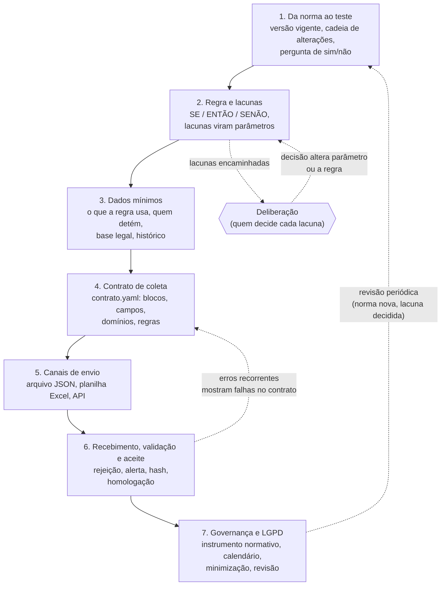

# Método: do teste de auditoria ao padrão de coleta de dados

Este método ajuda uma agência reguladora a responder, de forma ordenada, a uma pergunta prática:

> **"Quero verificar automaticamente se o regulado cumpre a obrigação X. Que dados preciso pedir, a quem, em que formato e com que garantias?"**

A resposta não começa pelo formato do arquivo. Começa pela **norma** e pelo **teste de auditoria** que o fiscal já faz (ou gostaria de fazer). O padrão de coleta é consequência do teste: só se pede o dado que alguma regra usa.

## Por que um método

A experiência mostra que pedir dados "para fiscalizar" sem antes escrever a regra leva a três problemas recorrentes:

1. **A regra citada está desatualizada.** A obrigação foi alterada por normas posteriores, às vezes sem revogação expressa, e a coleta é desenhada para uma regra que já não vale.
2. **A regra tem lacunas que ninguém decidiu.** Termos indefinidos, prazos sem forma de contagem, conflitos entre normas. O sistema de verificação acaba "chutando" uma interpretação, e o resultado não se sustenta numa defesa administrativa.
3. **Os dados pedidos não servem para o teste.** Faltam datas, faltam chaves estáveis, falta o histórico, ou o dado está com outro detentor que não o regulado.

O método trata esses três problemas antes de qualquer linha de código ou planilha.

## As 7 etapas

As setas pontilhadas mostram que o método é um ciclo: uma deliberação sobre uma lacuna muda a regra; um erro recorrente no recebimento revela um campo mal definido; uma norma nova reabre a primeira etapa.

## Para quem é cada etapa

| Etapa | Documento | Quem conduz | Quem participa |
|---|---|---|---|
| 1. Da norma ao teste | [01-da-norma-ao-teste.md](01-da-norma-ao-teste.md) | fiscalização (área técnica do setor) | procuradoria |
| 2. Regra e lacunas | [02-regra-e-lacunas.md](02-regra-e-lacunas.md) | fiscalização | procuradoria, diretoria ou conselho (decisão das lacunas) |
| 3. Dados mínimos | [03-dados-minimos.md](03-dados-minimos.md) | fiscalização | TI da agência, encarregado de dados pessoais |
| 4. Contrato de coleta | [04-contrato-de-coleta.md](04-contrato-de-coleta.md) | TI da agência | fiscalização (valida o conteúdo) |
| 5. Canais de envio | [05-canais-de-envio.md](05-canais-de-envio.md) | TI da agência | TI dos regulados |
| 6. Recebimento, validação e aceite | [06-recebimento-validacao-e-aceite.md](06-recebimento-validacao-e-aceite.md) | TI da agência | fiscalização, TI dos regulados |
| 7. Governança e LGPD | [07-governanca-e-lgpd.md](07-governanca-e-lgpd.md) | procuradoria e diretoria | fiscalização, encarregado de dados pessoais, TI |

## Princípios que atravessam o método

- **Nunca chute.** Todo teste tem três saídas: `CONFORME`, `NAO_CONFORME` e `PRECISA_DE_DELIBERACAO`. Quando a norma é ambígua ou o dado é insuficiente, a resposta honesta é a terceira.
- **Toda lacuna é um parâmetro explícito**, com valor padrão provisório, fundamento e indicação de quem decide. O verificador registra quais lacunas influenciaram cada veredito.
- **A data que importa é a do fato.** Habilitações, credenciamentos, tarifas e prazos são avaliados na data em que o fato ocorreu, não na data da verificação.
- **Um contrato de dados, vários canais.** O conteúdo é definido uma única vez; API, planilha e arquivo JSON são apenas meios de transporte.
- **Pedir o mínimo.** Só entra no contrato o dado que alguma regra usa. Dado pessoal só quando indispensável.
- **A agência busca o que é público.** Listas oficiais (acreditações, registros profissionais, cadastros públicos) são obtidas pela própria agência, não pedidas ao regulado.

## Modelos para começar

A pasta [`../modelos/`](../modelos/) traz os formulários e minutas que acompanham o método:

| Modelo | Usado na etapa |
|---|---|
| [ficha-teste-auditoria.md](../modelos/ficha-teste-auditoria.md) | 1 a 3 |
| [catalogo-testes-comuns.md](../modelos/catalogo-testes-comuns.md) | 1 e 2 (ponto de partida) |
| [contrato-modelo.yaml](../modelos/contrato-modelo.yaml) | 4 |
| [checklist-homologacao.md](../modelos/checklist-homologacao.md) | 6 |
| [oficio-solicitacao-dados.md](../modelos/oficio-solicitacao-dados.md) | 7 |

O formato do arquivo de contrato está especificado em [`../docs/formato-contrato.md`](../docs/formato-contrato.md).

## Tempo típico

Para um teste de complexidade média (uma obrigação, duas ou três normas, três ou quatro blocos de dados), a experiência indica:

| Fase | Duração indicativa |
|---|---|
| Etapas 1 a 3 (análise normativa, regra, dados) | 2 a 4 semanas |
| Deliberação das lacunas principais | depende da pauta do colegiado; o trabalho segue com os valores padrão provisórios |
| Etapa 4 (contrato) | 1 semana |
| Etapas 5 e 6 até a homologação com o regulado | 6 a 10 semanas |
| Etapa 7 (instrumento normativo) | em paralelo às etapas 4 a 6 |

O trabalho não precisa esperar todas as deliberações: os valores padrão provisórios permitem rodar o verificador desde o início, e o próprio verificador mostra quantos casos dependem de cada decisão pendente, o que ajuda a priorizar a pauta.
